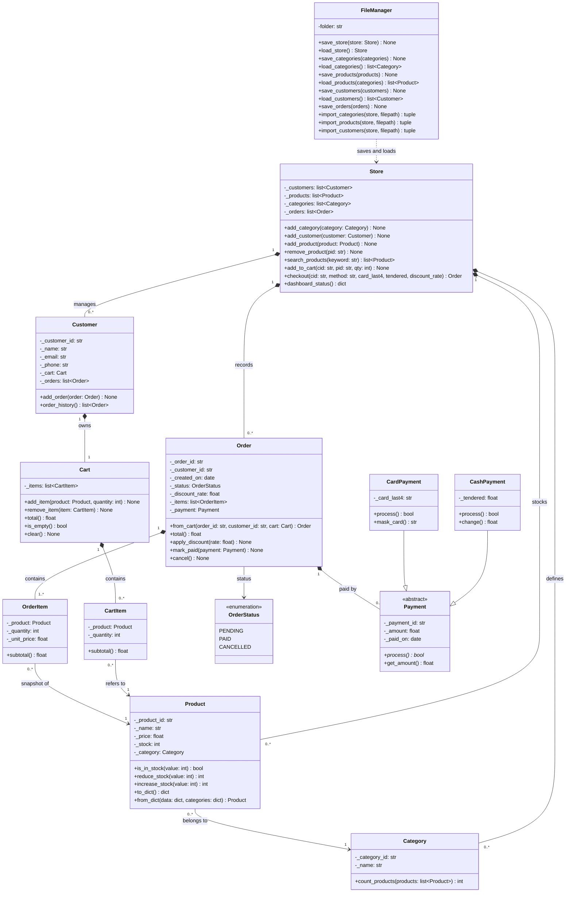
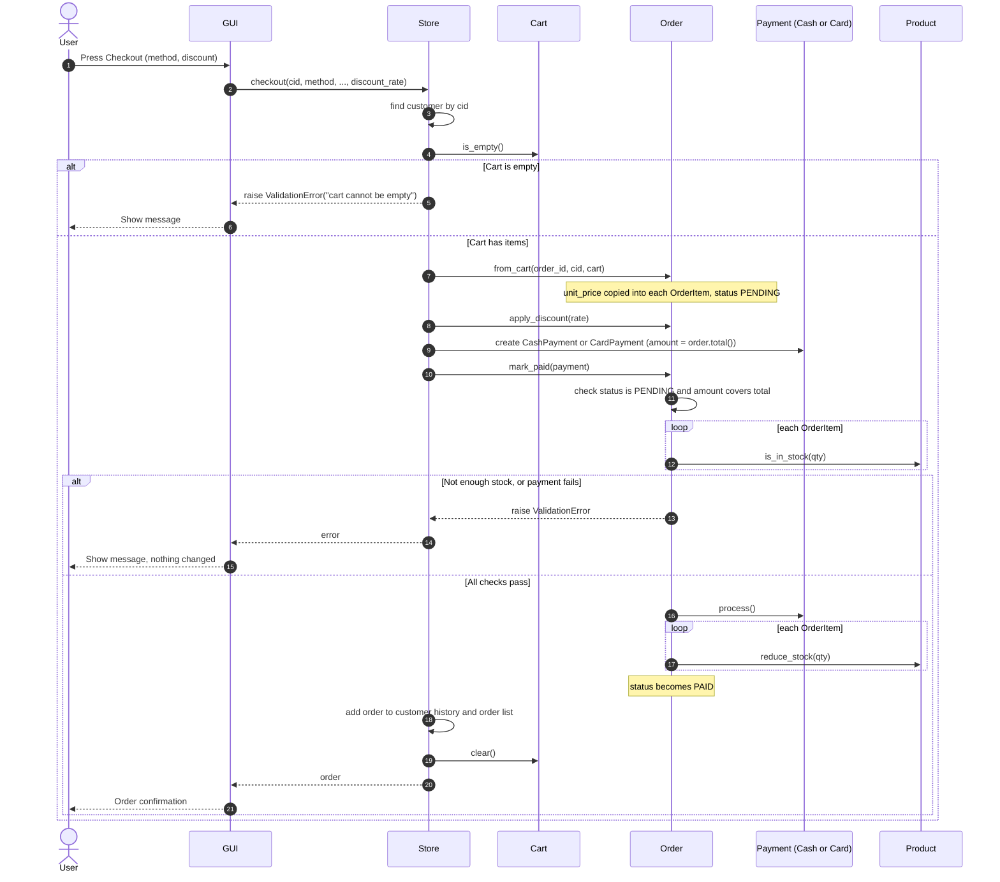
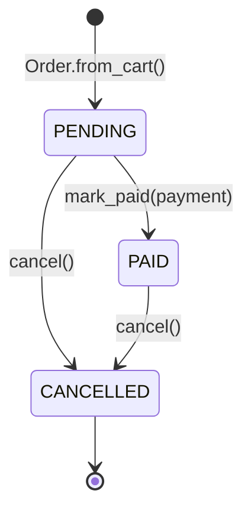

# Small E-Commerce System
 
**Version:** 1.0.0  
**Authors:** Amr Mohamed Ahmed, Mohamed Osama, Osama Hatem  
**Language:** Python 3.10+  
**Status:** Active Development
 
---
 
## Team
 
| Name |
|------|
| Amr Mohamed Ahmed |
| Mohamed Osama |
| Osama Hatem |
 
---
 
## 1. Overview
 
An object-oriented e-commerce system built in Python with a graphical user interface (tkinter). The project demonstrates core OOP principles: inheritance, polymorphism, composition and encapsulation, organised as a layered architecture.
 
### 1.1 Project Scope
 
The Small E-Commerce System is an implementation of an online store with:
 
- Category and product catalog management
- Customer carts and order processing
- Multiple payment methods (Cash and Card)
- Percentage discounts applied at checkout
- Persistent file-based data storage (JSON) and CSV import
- Order status tracking (Pending, Paid, Cancelled)
- An interactive tkinter interface for all operations
### 1.2 Key Features
 
| Feature | Description |
|---------|-------------|
| **Customer Management** | Add customers with validated name, email and phone; each customer has a cart and an order history |
| **Product Catalog** | Add, search and remove products; stock tracking; products belong to a category |
| **Shopping Cart** | Add and remove items; adding the same product again merges the quantity; live total |
| **Checkout System** | Empty-cart check, stock check, payment, stock deduction, order record |
| **Payment Processing** | Abstract `Payment` with `CashPayment` and `CardPayment` implementations |
| **Discounts** | A discount rate between 0 and 1 applied to an order before payment |
| **Order Management** | View orders; cancelling a paid order restores stock |
| **Data Persistence** | JSON save/load through `FileManager`, plus CSV import for categories, products and customers |
| **Dashboard** | Customers, products, orders today and total sales |
| **GUI Interface** | Tabbed tkinter application for all of the above |
 
---
 
## 2. Architecture
 
### 2.1 Layered Architecture
 
```
┌─────────────────────────────────────────────┐
│         GUI (Presentation Layer)            │
│              (gui/)                         │
├─────────────────────────────────────────────┤
│      Application/Service Layer              │
│          (store/ Store facade)              │
├─────────────────────────────────────────────┤
│         Domain Model Layer                  │
│         (models/) - Business Logic          │
├─────────────────────────────────────────────┤
│      Persistence Layer                      │
│      (file_manager/ FileManager)            │
└─────────────────────────────────────────────┘
```
 
The GUI talks to `Store`, `Store` works with the domain models, and `FileManager` reads and writes the data files.
 
### 2.2 Core Domain Model (14 Classes)
 
#### Entity Classes
 
| Class | Responsibility |
|-------|-----------------|
| `Customer` | Account details, owns a cart, keeps a list of its orders |
| `Product` | Catalog item with name, price, stock and category |
| `Category` | Product grouping |
| `Cart` | Shopping cart container |
| `CartItem` | One product and a quantity in a cart |
| `Order` | Purchase record with status, discount, items and payment |
| `OrderItem` | Order line with a **price snapshot** (`unit_price`), so later price changes don't alter old orders |
 
#### Value Objects, Enumerations and Errors
 
| Class | Responsibility |
|-------|-----------------|
| `OrderStatus` | Enum: PENDING, PAID, CANCELLED |
| `Payment` (abstract) | Base class for payment types |
| `CashPayment` | Cash payment with tendered amount and change |
| `CardPayment` | Card payment storing only the last 4 digits |
| `ValidationError` | Custom exception raised when data or a business rule is invalid |
 
#### Service and Utility Classes
 
| Class | Responsibility |
|-------|-----------------|
| `Store` | Application facade; coordinates customers, products, carts, checkout and statistics |
| `FileManager` | Saves and loads JSON files and imports CSV files |
 
### 2.3 Design Patterns
 
- **Facade:** `Store` hides the details of checkout, cart handling and lookups from the GUI.
- **Polymorphism / Strategy:** `CashPayment` and `CardPayment` implement the abstract `Payment.process()`, so an order accepts any payment type.
- **Repository-style persistence:** `FileManager` keeps file handling out of the domain classes.
- **Snapshot:** `OrderItem` copies the price at purchase time.
- **Factory method:** `Order.from_cart()` builds an order from a cart.
### 2.4 UML Diagrams
 
#### 2.4.1 Class Diagram
 

 
**Key relationships**
 
- **Composition:** `Store` owns its customers, products, categories and orders; `Customer` owns a `Cart`; `Cart` contains `CartItem`s; `Order` contains `OrderItem`s.
- **Association:** `CartItem` and `OrderItem` refer to a `Product`; `OrderItem` also stores the unit price at purchase time.
- **Inheritance:** `CashPayment` and `CardPayment` extend the abstract `Payment`.
- **Dependency:** `FileManager` reads and writes the data held by `Store`.
#### 2.4.2 Checkout Sequence Diagram
 

 
**Flow summary**
 
| Step | Action | Validation |
|------|--------|-----------|
| 1-4 | User starts checkout; `Store` finds the customer and checks the cart | Empty cart is rejected |
| 5-7 | Order is built from the cart; discount is applied; a payment object is created | Discount must be between 0 and 1; card digits are validated |
| 8-11 | `mark_paid` checks status, amount and stock for every item **before** taking payment | Any failure raises `ValidationError` and changes nothing |
| 12-15 | Payment is processed, stock is reduced, order becomes PAID | |
| 16-18 | Order is stored, cart is cleared, confirmation is shown | |
 
#### 2.4.3 Order Status State Diagram
 

 
| State | Meaning | Transitions |
|-------|---------|-------------|
| **PENDING** | Order created, not yet paid; stock untouched | PAID (payment succeeds) or CANCELLED |
| **PAID** | Payment accepted; stock deducted | CANCELLED (stock is restored) |
| **CANCELLED** | Order ended | Terminal; cancelling again raises an error |
 
---
 
## 3. Business Rules
 
### BR-01: Stock Validation on Purchase
Customers cannot buy more units than are in stock. The check runs inside `Order.mark_paid`, **before** the payment is processed, so a failed check never charges anyone or changes stock.
 
```python
for item in self._items:
    if not item.product.is_in_stock(item.quantity):
        raise ValidationError(f"not enough stock for {item.product.name}")
```
 
### BR-02: Non-Empty Checkout
A customer cannot check out with an empty cart.
 
```python
if cart.is_empty():
    raise ValidationError("cart cannot be empty")
```
 
### BR-03: Product Price Validation
Product prices must be numbers greater than zero.
 
```python
@price.setter
def price(self, value):
    if not isinstance(value, (int, float)) or value <= 0:
        raise ValidationError("the price must be bigger than zero")
    self._price = value
```
 
### BR-04: Automatic Order Total
The order total is always calculated from the line items and the discount; it is never stored or edited by hand.
 
```python
def total(self):
    subtotal = sum(item.subtotal() for item in self._items)
    return max(0.0, subtotal * (1 - self._discount_rate))
```
 
---
 
## 4. Directory Structure
 
```
ecommerce/
├── Enums/                  # Enumerations
│   ├── __init__.py
│   └── enums.py            # OrderStatus
├── data/                   # Created automatically: saved JSON files
├── data_seed/              # Sample / starting data
├── docs/                   # Documentation
├── file_manager/           # Persistence layer
│   ├── __init__.py
│   └── file_manager.py     # JSON save/load and CSV import
├── gui/                    # Presentation layer
│   ├── __init__.py
│   └── app.py              # tkinter application (StoreApp)
├── models/                 # Domain model
│   ├── __init__.py
│   ├── cart.py
│   ├── cartitem.py
│   ├── category.py
│   ├── customer.py
│   ├── order.py
│   ├── orderitem.py
│   ├── payment.py          # Payment, CardPayment, CashPayment
│   └── product.py
├── store/                  # Application service layer
│   ├── __init__.py
│   └── store.py            # Store facade
├── tests/                  # Tests
├── .gitignore
├── exceptions.py           # ValidationError
├── main.py                 # Console entry point
├── run_gui.py              # GUI launcher
├── requirements.txt
└── README.md
```
 
---
 
## 5. Installation and Setup
 
### 5.1 Prerequisites
 
- Python 3.10 or newer
- tkinter (included with the standard Python installer on Windows and macOS; on Debian/Ubuntu install it with `sudo apt install python3-tk`)
- A virtual environment is recommended
### 5.2 Installation Steps
 
```bash
# Clone the repository
git clone https://github.com/NeGaT1Vee/pyhon-project.git
cd pyhon-project
 
# Create and activate a virtual environment
python -m venv .venv
.venv\Scripts\activate        # Windows
source .venv/bin/activate     # macOS / Linux
```
 
The application itself uses only the Python standard library, so no extra packages are required to run it. Install anything listed in `requirements.txt` (for example a test runner) with:
 
```bash
pip install -r requirements.txt
```
 
---
 
## 6. Usage
 
### 6.1 Launch the GUI
 
Run this from the project root folder:
 
```bash
python run_gui.py
```
 
Tabs in the window:
 
| Tab | What you can do |
|-----|-----------------|
| Categories | Add categories, see how many products each has |
| Products | Search, add and remove products |
| Customers | Add and list customers |
| Shop / Cart | Pick a customer and product, add to cart, choose card or cash, enter a discount %, check out |
| Orders | View orders and cancel the selected one |
| Dashboard | Customers, products, orders today, total sales |
 
Press **Save data** (or close the window) to write the data to the `data` folder. It is loaded again the next time the app starts.