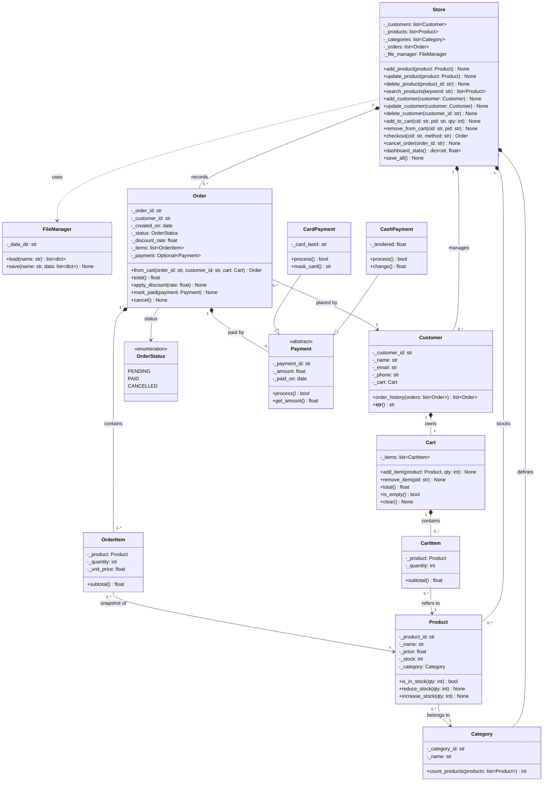
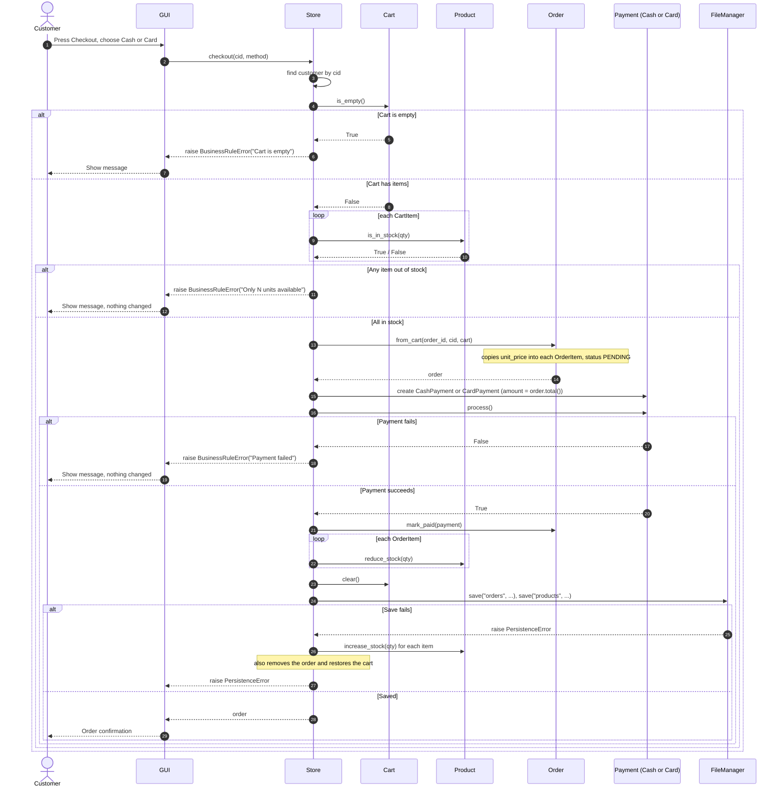
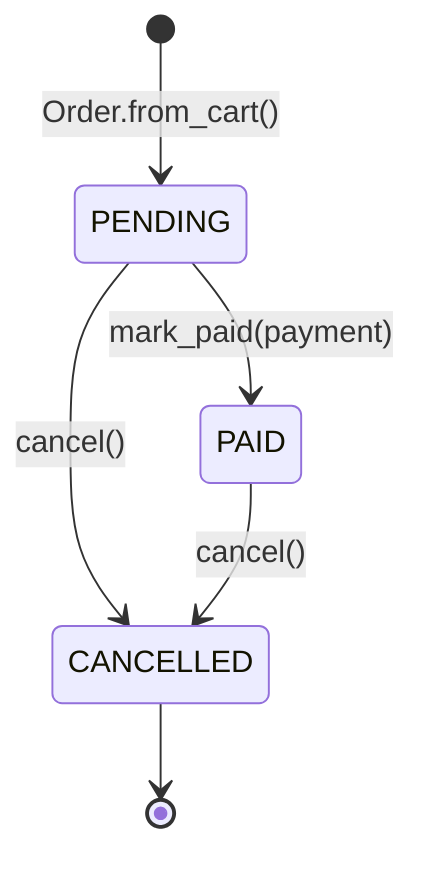

# Small E-Commerce System

**Version:** 1.0.0  
**Author:** NeGaT1Vee  
**Language:** Python 3.8+  
**Status:** Active Development  
----
<div align="center">

*A robust, object-oriented e-commerce backend built entirely from scratch in Python with local JSON persistence, micro-testing, and an interactive GUI.*

[](https://negat1vee.github.io/pyhon-project/)
[](https://www.python.org/)

</div>

---

## 📋 Project Overview
This repository contains a modular e-commerce backend engine engineered by **Osama Hatem, Mohamed Osama, and Amr Mohamed**. It implements strict architectural patterns (Facade, Repository, and Polymorphic Payments) without relying on external databases.

### ⚡ Interactive Presentation
Want a deep-dive walkthrough of the architecture, UML diagrams, and code snippets? 
👉 **[Click Here to Launch the Cinematic Web Presentation](https://negat1vee.github.io/pyhon-project/)**

---

## 1. Overview

A fully-functional object-oriented e-commerce system built in Python with a graphical user interface (GUI). The system demonstrates core OOP principles including inheritance, polymorphism, composition, and encapsulation through a complete domain-driven architecture.

### 1.1 Project Scope

The Small E-Commerce System is a complete implementation of an online store with:
- Multi-category product catalog management
- Customer cart and order processing
- Multiple payment methods (Cash, Card, Wallet)
- Dynamic discount system (percentage and fixed-amount)
- Persistent file-based data storage
- Full audit trail for order history
- Interactive Qt-based graphical interface

### 1.2 Key Features

| Feature | Description |
|---------|-------------|
| **Customer Management** | Register, login, profile management with order history |
| **Product Catalog** | Browse by category, search, stock tracking |
| **Shopping Cart** | Add/remove items, dynamic total calculation |
| **Checkout System** | Multi-step validation, inventory deduction, order confirmation |
| **Payment Processing** | Abstract payment types with Cash/Card/Wallet implementations |
| **Discount Engine** | Polymorphic discount types: percentage and fixed-amount |
| **Order Management** | Status tracking (Pending → Paid → Completed or Cancelled) |
| **Data Persistence** | JSON-based file storage with transaction safety |
| **GUI Interface** | User-friendly PyQt5 application for all operations |

---

## 2. Architecture

### 2.1 Layered Architecture

```
┌─────────────────────────────────────────────┐
│         GUI (Presentation Layer)            │
│              (gui/)                         │
├─────────────────────────────────────────────┤
│      Application/Service Layer              │
│          (store/Store Facade)               │
├─────────────────────────────────────────────┤
│         Domain Model Layer                  │
│         (models/) - Business Logic          │
├─────────────────────────────────────────────┤
│      Persistence Layer                      │
│      (file_manager/FileManager)             │
└─────────────────────────────────────────────┘
```

**Dependency Flow:** GUI → Application → Domain → Persistence (One-way, no circular dependencies)

### 2.2 Core Domain Model (14 Classes)

#### **Entity Classes**

| Class | Responsibility |
|-------|-----------------|
| `Customer` | User account, personal data, reference to cart and order history |
| `Product` | Catalog item with name, price, stock, category |
| `Category` | Product grouping and organization |
| `Cart` | Shopping cart container, tracks selected items |
| `CartItem` | Individual item in cart with quantity snapshot |
| `Order` | Finalized purchase record with immutable details |
| `OrderItem` | Line item in order with price snapshot (prevents history corruption) |

#### **Value Objects & Enumerations**

| Class | Responsibility |
|-------|-----------------|
| `OrderStatus` | Enum: PENDING, PAID, CANCELLED |
| `Discount` (Abstract) | Base for discount strategies |
| `PercentageDiscount` | Apply percentage-based reductions |
| `FixedDiscount` | Apply fixed-amount reductions |
| `Payment` (Abstract) | Base for payment strategies |
| `CashPayment` | In-person cash payment |
| `CardPayment` | Credit/debit card payment |
| `WalletPayment` | Digital wallet/account balance payment |

#### **Service & Utility Classes**

| Class | Responsibility |
|-------|-----------------|
| `Store` | Application facade; orchestrates all business operations |
| `FileManager` | Persistence abstraction; JSON serialization/deserialization |

### 2.3 Design Patterns

**Applied Patterns:**
- **Facade Pattern:** `Store` class simplifies complex subsystem interactions
- **Strategy Pattern:** `Discount` and `Payment` hierarchies allow runtime behavior selection
- **Repository Pattern:** `FileManager` abstracts data storage implementation
- **Value Object Pattern:** `CartItem`, `OrderItem` encapsulate immutable snapshots
- **Builder-like Construction:** Order creation via checkout flow

### 2.4 UML Diagrams

#### **2.4.1 Class Diagram**



**Key Relationships:**
- **Composition:** `Store` owns collections of `Customer`, `Product`, `Category`, `Order`
- **Aggregation:** `Customer` owns `Cart`; `Cart` contains `CartItem`s; `Order` contains `OrderItem`s
- **Association:** `CartItem` and `OrderItem` reference `Product` (snapshots capture unit prices)
- **Inheritance:** `CashPayment` and `CardPayment` extend abstract `Payment`
- **Dependency:** `Store` depends on `FileManager` for persistence

---

#### **2.4.2 Checkout Sequence Diagram**



**Sequence Flow Explanation:**

| Step | Action | Validation |
|------|--------|-----------|
| 1-3 | Customer initiates checkout | Store locates customer and checks cart |
| 4-8 | **BR-02 Check:** Empty cart validation | If empty → terminate with error |
| 9-12 | **BR-01 Check:** Stock availability for all items | If insufficient → terminate, no state change |
| 13-16 | Order created from cart snapshot | Unit prices frozen in OrderItem records |
| 17-22 | Payment processing via abstract Payment interface | If fails → terminate, no state change |
| 23-28 | **All-or-nothing commit:** Stock reduced, cart cleared, data persisted | If save fails → rollback stock, remove order, restore cart |
| 29-30 | Customer receives confirmation | Order ID and receipt shown |

**Rollback Safety:** If persistence fails at step 27, lines 28-30 automatically restore inventory and remove the order record, maintaining consistency.

---

#### **2.4.3 Order Status State Diagram**



**State Definitions:**

| State | Meaning | Transitions |
|-------|---------|-------------|
| **PENDING** | Order created; awaiting payment | → PAID (payment success) or → CANCELLED (customer cancels) |
| **PAID** | Payment processed successfully; stock deducted | → CANCELLED (customer requests refund) or → [*] (completed) |
| **CANCELLED** | Order terminated; stock restored if applicable | → [*] (terminal state) |

**Business Rules by State:**
- **PENDING:** Stock is held but not deducted; order can be cancelled anytime
- **PAID:** Stock is committed; cancellation triggers refund workflow and inventory restoration
- **CANCELLED:** Final; no further state changes allowed

---

## 3. Business Rules (BR-01 to BR-04)

### BR-01: Stock Validation on Purchase
**Requirement:** Customers cannot purchase more units than available inventory.

**Implementation:**
```python
# Validated at two checkpoints:
# 1. When adding to cart
cart.add_item(product, quantity)  # Raises BusinessRuleError if qty > stock

# 2. Before checkout (re-check for concurrent orders)
store.checkout(customer, payment)  # Raises BusinessRuleError if stock insufficient
```

**Rationale:** Double validation prevents race conditions and ensures consistency.

---

### BR-02: Non-Empty Checkout
**Requirement:** Customers cannot proceed to checkout with an empty cart.

**Implementation:**
```python
def checkout(self, customer: Customer, payment: Payment) -> Order:
    if not customer.cart.items:
        raise ValidationError("Cannot checkout with an empty cart")
```

**Rationale:** Prevents meaningless order creation and ensures business value.

---

### BR-03: Product Price Validation
**Requirement:** Product prices must be positive values.

**Implementation:**
```python
class Product:
    @property
    def price(self) -> float:
        return self._price
    
    @price.setter
    def price(self, value: float) -> None:
        if value <= 0:
            raise ValidationError("Product price must be positive")
        self._price = value
```

**Rationale:** Ensures data integrity and prevents illogical pricing scenarios.

---

### BR-04: Automatic Order Total Calculation
**Requirement:** Order total is calculated automatically from line items; never stored independently or manually edited.

**Implementation:**
```python
class Order:
    @property
    def total(self) -> float:
        """Always calculated from current items; read-only"""
        return sum(item.subtotal for item in self.items)
```

**Rationale:** Single source of truth; eliminates rounding inconsistencies and audit issues.

---

## 4. Directory Structure

```
pyhon-project/
├── Enums/                      # Enumeration definitions
│   ├── __init__.py
│   └── order_status.py         # OrderStatus enum
├── data/                       # Runtime data storage
│   ├── customers.json
│   ├── products.json
│   ├── categories.json
│   ├── orders.json
│   └── ...
├── data_seed/                  # Initial data population scripts
│   ├── __init__.py
│   └── seed.py                 # Database initialization fixtures
├── docs/                       # Documentation
│   ├── README.md
│   ├── API.md
│   ├── ARCHITECTURE.md
│   └── UML/                    # UML diagrams
├── file_manager/               # Persistence layer
│   ├── __init__.py
│   └── file_manager.py         # JSON I/O abstraction
├── gui/                        # User interface layer
│   ├── __init__.py
│   ├── main_window.py          # Main application window
│   ├── customer_view.py        # Customer dashboard
│   ├── product_view.py         # Product catalog view
│   ├── cart_view.py            # Shopping cart interface
│   └── order_view.py           # Order history/confirmation
├── models/                     # Domain model (business logic)
│   ├── __init__.py
│   ├── customer.py
│   ├── product.py
│   ├── category.py
│   ├── cart.py
│   ├── order.py
│   ├── payment.py              # Abstract + implementations
│   ├── discount.py             # Abstract + implementations
│   └── exceptions.py           # Custom exception hierarchy
├── store/                      # Application service layer
│   ├── __init__.py
│   └── store.py                # Store facade
├── tests/                      # Unit and integration tests
│   ├── __init__.py
│   ├── test_models.py
│   ├── test_store.py
│   ├── test_file_manager.py
│   └── test_gui.py
├── .gitignore
├── main.py                     # CLI entry point
├── run_gui.py                  # GUI application launcher
├── requirements.txt            # Python dependencies
└── README.md                   # This file
```

---

## 5. Installation & Setup

### 5.1 Prerequisites

- Python 3.8 or higher
- pip package manager
- Virtual environment (recommended)

### 5.2 Installation Steps

```bash
# Clone the repository
git clone https://github.com/NeGaT1Vee/pyhon-project.git
cd pyhon-project

# Create and activate virtual environment
python -m venv venv
source venv/bin/activate  # On Windows: venv\Scripts\activate

# Install dependencies
pip install -r requirements.txt

# Initialize database with seed data
python data_seed/seed.py
```

### 5.3 Dependencies

| Package | Version | Purpose |
|---------|---------|---------|
| PyQt5 | 5.15.x | GUI framework |
| requests | 2.28.x | HTTP client (optional extensions) |
| pytest | 7.x | Testing framework |
| pytest-cov | 4.x | Coverage analysis |

See `requirements.txt` for complete list.

---

## 6. Usage

### 6.1 Launch GUI Application

```bash
python run_gui.py
```

Starts the main application window with:
- Customer login/registration
- Product browsing by category
- Shopping cart management
- Checkout and payment processing
- Order history view

### 6.2 Command-Line Usage

```bash
python main.py
```

Interactive CLI for:
- Direct store operations
- Batch data imports
- Administrative functions
- Testing without GUI

### 6.3 Common Workflows

#### **Customer Registration & Shopping**
```python
from store import Store

store = Store()

# Register
customer = store.register_customer("john@example.com", "password123", "John Doe")

# Browse products
categories = store.get_all_categories()
products = store.get_products_by_category(categories[0])

# Add to cart
store.add_to_cart(customer, products[0], quantity=2)

# Checkout
from models.payment import CardPayment
payment = CardPayment(card_number="4111111111111111")
order = store.checkout(customer, payment)

print(f"Order #{order.id} placed successfully. Total: ${order.total:.2f}")
```

#### **Apply Discount**
```python
from models.discount import PercentageDiscount

discount = PercentageDiscount(percentage=10)
discounted_total = discount.apply(order.total)  # 10% off
```

#### **Process Payment**
```python
from models.payment import WalletPayment

wallet = WalletPayment(account_balance=100.00)
if wallet.process(order.total):
    print("Payment successful")
else:
    print("Insufficient balance")
```

---

## 7. Testing

### 7.1 Run All Tests

```bash
pytest tests/ -v
```

### 7.2 Generate Coverage Report

```bash
pytest tests/ --cov=models --cov=store --cov-report=html
```

### 7.3 Test Categories

| Module | Tests | Coverage Goal |
|--------|-------|---------------|
| `models/` | 40+ unit tests | 95% |
| `store/` | 20+ integration tests | 90% |
| `file_manager/` | 15+ I/O tests | 90% |
| `gui/` | 10+ functional tests | 70% |


---

## 8. Data Persistence

### 8.1 JSON Schema

**customers.json:**
```json
{
  "customers": [
    {
      "id": "cust_001",
      "email": "customer@example.com",
      "name": "John Doe",
      "password_hash": "...",
      "created_at": "2024-01-15T10:30:00Z",
      "cart": {
        "items": [
          {"product_id": "prod_001", "quantity": 2, "unit_price": 29.99}
        ]
      },
      "order_history": ["order_001", "order_002"]
    }
  ]
}
```

**orders.json:**
```json
{
  "orders": [
    {
      "id": "order_001",
      "customer_id": "cust_001",
      "status": "PAID",
      "items": [
        {
          "product_id": "prod_001",
          "product_name": "Laptop",
          "quantity": 1,
          "unit_price": 999.99,
          "subtotal": 999.99
        }
      ],
      "discount": {"type": "percentage", "value": 10},
      "payment": {"type": "card", "method": "VISA"},
      "total": 899.99,
      "created_at": "2024-01-15T11:00:00Z",
      "completed_at": null
    }
  ]
}
```

### 8.2 Transaction Safety

All write operations follow ACID principles:
1. **Atomicity:** All-or-nothing checkout (stock deduction rollback on failure)
2. **Consistency:** Business rules enforced before persisting
3. **Isolation:** File-level locking prevents concurrent corruption
4. **Durability:** Synchronous writes to disk

---

## 9. Development Workflow

### 9.1 Development Setup

```bash
# Install dev dependencies
pip install -r requirements-dev.txt

# Pre-commit hooks for code quality
pre-commit install

# Enable git flow
git flow init
```

### 9.2 Code Organization Principles

1. **One class per file** (except related value objects)
2. **Type hints** on all method signatures
3. **Docstrings** for public APIs (Google style)
4. **Private attributes** prefixed with underscore
5. **No circular imports** between layers
6. **Custom exceptions** for domain errors

### 9.3 Git Workflow

```bash
# Feature branch
git flow feature start add-inventory-management
git add .
git commit -m "Add inventory management feature"
git flow feature finish add-inventory-management

# Release branch
git flow release start 1.1.0
git flow release finish 1.1.0
```

---

## 10. Known Limitations & Future Work

### 10.1 Current Limitations

| Limitation | Impact | Workaround |
|-----------|--------|-----------|
| File-based storage | Not suitable for concurrent users | Use database migration in v2.0 |
| No authentication tokens | Sessions lost on app restart | Implement JWT in next version |
| Single-threaded GUI | Can freeze on large data loads | Implement async/await patterns |
| No inventory sync | Orders placed simultaneously may fail | Add optimistic locking |


---

## 11. Troubleshooting

### 11.1 Common Issues

**Issue:** `ModuleNotFoundError: No module named 'PyQt5'`
```bash
# Solution: Install GUI dependencies
pip install -r requirements.txt
```

**Issue:** `FileNotFoundError: [Errno 2] No such file or directory: 'data/customers.json'`
```bash
# Solution: Initialize database
python data_seed/seed.py
```

**Issue:** Permission denied on data files
```bash
# Solution: Fix file permissions
chmod 644 data/*.json
```

---

## 12. Contact & Support
| Contact Method | Details |
|---|---|
| **Repository Issues** | [GitHub Issues](https://github.com/NeGaT1Vee/pyhon-project/issues) |
| **Authors** | [NeGaT1Vee](https://github.com/NeGaT1Vee) • [Mohamed Osama](https://github.com/mohamedosamahieba2892005-crypto) • [Osama Hatem](https://github.com/osama1hatem2abdelkreem3) |
| **Email** | Contact via GitHub |

---


**Document Version:** 1.0  
**Last Updated:** October 2026  
**Status:** Active